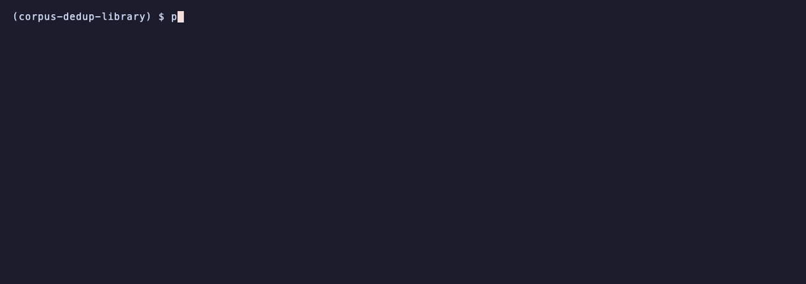
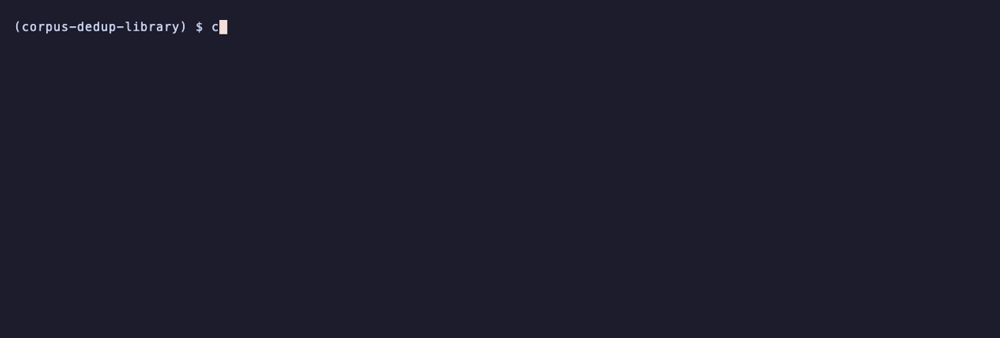

<h1 align="center">Corpus Dedup Library</h1>

<p align="center">
  <em>A corpus near-deduplication and quality-filtering library built from scratch in Python with a bit-exact Rust core, using MinHash and locality-sensitive hashing, scored for precision, recall, and the fraction of document pairs compared.</em>
</p>

<p align="center">
  <a href="https://github.com/adeoluo/corpus-dedup-library/actions/workflows/ci.yml"></a>
  <a href="https://github.com/adeoluo/corpus-dedup-library/releases"></a>
  
  
  <a href="LICENSE"></a>
</p>

---

## Motivation

The quality of a language model is bounded by the quality of its training data, and two of the most
important cleaning steps are **near-deduplication** (removing documents that are near-copies of
each other) and **quality filtering** (dropping degenerate text). Exact deduplication by comparing
every pair is quadratic and misses near-copies that differ by an edit. This library implements the
standard scalable approach from scratch: **MinHash** estimates
Jaccard similarity cheaply, and **locality-sensitive hashing** shortlists only the pairs likely to
be similar, so the work stays close to linear.

The headline is that it works and that it is cheap: on a labeled corpus it removes near-duplicates
with **perfect precision and recall** while comparing a small fraction of all pairs, and the saving
grows with corpus size.

## Architecture

<p align="center">
  
</p>

<sub>Legend: amber = entry points and external systems, indigo = core logic, green = data and state, blue = validation and control, grey = observability and outputs.</sub>

Each document is shingled into hashed word k-grams; MinHash reduces the shingle set to a compact
signature; LSH bands the signatures and buckets them so that similar documents collide; candidate
pairs are verified against a Jaccard threshold; and a union-find groups confirmed duplicates so one
representative per cluster is kept. Quality filtering runs separately, applying configurable
heuristic rules to each document and returning the reasons it failed. The HTTP service validates
batch and document sizes, keeps no corpus between requests, and exposes Prometheus metrics; the
report scores detection precision and recall against a synthetic corpus with known duplicates.
See the [ADRs](docs/adr/) for the key decisions.

### What it implements

- **MinHash** with a deterministic 64-bit hash and a family of ``(a*h + b) mod p`` permutations, so
  signature agreement is an unbiased estimate of Jaccard similarity.
- **LSH banding** with tunable bands and rows to set the similarity threshold for collision.
- **A deduplication pipeline**: candidate generation, threshold verification (estimated or exact),
  union-find clustering, and representative selection.
- **A Rust core** (`rust/`): the same MinHash, LSH banding, and clustering, bit-exact with the
  Python reference, computing signatures in parallel with the GIL released. It is exposed to
  Python as the default backend (compiled into the package on install) and as a standalone
  `corpus-dedup` command for JSONL streams. The Python implementation is the reference.
- **Heuristic quality filters**: length, mean word length, stop-word ratio, symbol ratio, and word
  repetition, each an inspectable rule.

## Results

> Reproduce with `python -m corpus_dedup_library report`. A labeled corpus injects known
> near-duplicates (exact copies, an appended clause, a changed word) so detection can be scored.

| Corpus size | Precision | Recall | Pairs compared | Fewer than all-pairs |
|---|---:|---:|---:|---:|
| 90 documents | 1.000 | 1.000 | 52 / 4,005 | **77x** |
| 270 documents | 1.000 | 1.000 | 174 / 36,315 | **209x** |

Detection is exact on this corpus (**precision and recall 1.000**), and LSH compares only a tiny
fraction of all pairs. Because the number of candidate pairs grows far more slowly than the
quadratic all-pairs count, the reduction **grows with corpus size**, from 77x at 90 documents to
209x at 270.

### Scale, throughput, and memory

> Reproduce with `python -m corpus_dedup_library` then `uv run python benchmarks/scale.py`.
> Synthetic corpora (two thirds unique, one third near-copies). Peak memory is measured with
> `tracemalloc`.

| Documents | Runtime | Throughput | Peak memory | Candidate pairs | Fewer than all-pairs | Precision | Recall |
|---|---:|---:|---:|---:|---:|---:|---:|
| 1,050 | 3.6 s | ~288 docs/s | 8.1 MiB | 442 | 1,246x | 1.000 | 0.997 |
| 3,000 | 10.5 s | ~285 docs/s | 22.9 MiB | 1,310 | 3,434x | 1.000 | 0.988 |
| 6,000 | 21.1 s | ~284 docs/s | 45.7 MiB | 2,634 | 6,833x | 1.000 | 0.992 |
| 10,500 | 37.5 s | ~280 docs/s | 80.4 MiB | 4,900 | 11,249x | 1.000 | 0.995 |

Throughput holds roughly constant per document and memory grows linearly with corpus size, while
the candidate-pair reduction keeps widening (over 11,000x at 10,500 documents). Adversarial duplicate
shapes (exact, odd whitespace, repeated text, and near-copies with appended non-ASCII text) are
detected; a low-overlap semantic paraphrase is **not** detected, which is the expected boundary of
word-shingle MinHash (it measures lexical overlap, not meaning), not an implementation defect. These
remain synthetic corpora: they measure throughput and memory behavior, not accuracy on real web text
at pretraining scale.

### Real web text at scale (C4)

> Reproduce: download C4 English shards from
> `https://huggingface.co/datasets/allenai/c4/resolve/main/en/c4-train.0000N-of-01024.json.gz`,
> then `corpus-dedup --input c4.jsonl --output deduped.jsonl` and
> `uv run --no-sync --with datasketch python benchmarks/compare_datasketch.py --c4 <shard>`.
> Apple M1, 8 cores.

**1.4 million documents.** The command-line tool deduplicates the first four C4 shards,
1,425,269 real web documents (3.3 GB of JSONL), in **30.5 seconds** with a peak memory of
1.2 GB. It drops 48,572 near-duplicates (3.4%) in 10,137 clusters after checking 4.6 million
candidate pairs. With `--input`, only signatures and byte offsets are held in memory and the
kept lines are copied from the file in a second pass, so memory grows with the number of
documents, not their length.

**Against datasketch**, the most widely used Python MinHash LSH library, on the first
50,000 C4 documents (threshold 0.6, 64 permutations, word bigrams).
Every pair either library reports is checked with the exact Jaccard similarity; recall is
measured against the 4,082 truly similar pairs that any of the runs found.

| Library | Time | Documents per second | Pairs reported | Precision | Recall |
|---|---:|---:|---:|---:|---:|
| corpus-dedup-library (Rust backend) | 6.0 s | 8,342 | 3,824 | 0.876 | 0.821 |
| **corpus-dedup-library (Rust backend, exact=True)** | **5.2 s** | 9,528 | 4,044 | **1.000** | **0.991** |
| datasketch MinHashLSH | 71.1 s | 703 | 2,662 | 0.974 | 0.635 |

These timings were taken with other applications loading the machine, so all three rows are
several times slower than on an idle M1 (an earlier idle run took 0.9 s for the default mode and
14.8 s for datasketch). The ratios between rows are what this table measures.

The default mode confirms candidates with the MinHash estimate and lets some false pairs through
(precision 0.876). `exact=True` confirms each candidate with the exact Jaccard similarity of the
two documents' shingle sets, now computed in Rust in parallel, so it costs no more time than the
estimate: **precision 1.000 and recall 0.991, 13.7x faster than datasketch**, which reports fewer
pairs (higher precision than the estimate mode, but recall 0.635 because its banding is tuned more
conservatively). On 10,000 documents the Rust backend is 144x faster than this library's own
Python backend in the same loaded run (215x on the idle machine).

### Rust core

> Reproduce with `make bench-compare`. Synthetic corpora of 80 to 200 word documents
> with one planted near-copy per five documents; default settings (16 bands of 4 rows, k=2,
> threshold 0.6); Apple M1, 8 cores.

| Documents | Python | Rust | Speedup | Identical result |
|---:|---:|---:|---:|:---:|
| 1,200 | 2.07 s | 0.014 s | 149x | yes |
| 6,000 | 10.27 s | 0.059 s | 175x | yes |
| 24,000 | 41.27 s | 0.260 s | 159x | yes |

The Python implementation stays the reference. The Rust backend returns the same
`DedupResult` (kept and dropped ids, confirmed pairs, clusters), which the parity tests check
on random and adversarial Unicode text, including Python's whitespace and lowercasing rules.

### Evaluation

The labeled corpus and all hashing are deterministic, so every number reproduces offline. Full
method and tables: [`docs/EVALUATION_REPORT.md`](docs/EVALUATION_REPORT.md).

### Comparison scope

The reported precision, recall, and candidate-pair reduction are measured on a small synthetic
corpus (90 to 270 documents) with injected near-duplicates, against an exhaustive all-pairs
baseline, not against an established deduplication pipeline at scale. Perfect accuracy on injected
duplicates is not evidence of the same accuracy on diverse web text, and this corpus is far below
pretraining scale. This project has **not** been benchmarked against
[datatrove](https://github.com/huggingface/datatrove) or
[text-dedup](https://github.com/ChenghaoMou/text-dedup), and it does not claim to beat them. What
the result establishes is the correctness of the MinHash and LSH mechanics and the sublinear growth
of candidate pairs. A large-scale evaluation with memory and throughput measurements is the natural
next step.

## Quickstart

```bash
git clone https://github.com/adeoluo/corpus-dedup-library.git && cd corpus-dedup-library
make setup                      # install (compiles the Rust core; needs a Rust toolchain) + hooks
make all                        # lint + type-check + test

python -m corpus_dedup_library report      # detection precision and recall
python -m corpus_dedup_library dedup        # deduplicate the built-in corpus
python -m corpus_dedup_library quality       # apply the quality filter
python -m corpus_dedup_library serve         # start the HTTP service on :8000
```

```python
from corpus_dedup_library import deduplicate, assess

result = deduplicate(["the cat sat here", "the cat sat here too", "unrelated finance text"])
print(result.keep, result.drop)
print(assess("!!! @@@ ###").reasons)  # ('too_few_stopwords', 'too_many_symbols')
```

## Usage

A real run of the Rust CLI on 24,000 synthetic documents with 4,000 planted near-copies. Regenerate with `vhs docs/demo/dedup.tape`.

<p align="center">
  
</p>

### Demonstration

```text
$ python -m corpus_dedup_library report
Near-duplicate detection against ground truth:
  precision=1.000, recall=1.000, f1=1.000; 52/4005 pairs compared (77x fewer)

$ python -m corpus_dedup_library quality
Quality filter over 93 documents:
  kept 90, rejected 3
  doc 90: too_few_words, too_few_stopwords
  doc 91: too_few_stopwords, too_many_symbols
  doc 92: too_repetitive
```

### Rust backend and CLI

Installing the package compiles the Rust core into it, and `deduplicate` uses it by default.
After editing `rust/`, `make rust-develop` rebuilds it in place.

```python
from corpus_dedup_library.dedup import deduplicate

result = deduplicate(documents)  # Rust core (backend="auto")
exact = deduplicate(documents, exact=True)  # exact Jaccard check, also in Rust
reference = deduplicate(documents, backend="python")  # identical result, readable reference
```

The same core ships as a command that streams JSONL, keeps the first line of each
near-duplicate cluster in input order, and writes a summary to stderr. Install it with
Homebrew (built from the tagged source) or build it from this repository:

```text
$ brew install adeoluo/tap/corpus-dedup
$ curl -fsSL https://raw.githubusercontent.com/adeoluo/corpus-dedup-library/main/scripts/install.sh | sh   # prebuilt, checksum verified
$ corpus-dedup --threshold 0.6 < corpus.jsonl > deduped.jsonl
documents=2400 kept=2000 dropped=400 clusters=400 candidate_pairs=400 seconds=0.030
```

### HTTP service

A standard-library HTTP service holds no corpus state; each request carries its own documents. The
routing logic is a pure function, tested without a socket.

| Method | Path | Purpose |
|---|---|---|
| GET | `/health` | liveness |
| GET | `/ready` | readiness |
| GET | `/metrics` | per-route request, error, and latency metrics (Prometheus text) |
| POST | `/dedup` | body `{"documents": [str], "threshold": float?}`; keep and drop ids |
| POST | `/quality` | body `{"text": str}`; whether the text passes and why not |
| GET | `/report` | near-duplicate detection precision and recall on the built-in corpus |

### Demos

Recorded from real runs with [vhs](https://github.com/charmbracelet/vhs); each tape is in `docs/demo/`.

Detection precision and recall on the labeled corpus, then the quality filter.

<p align="center">
  
</p>

The HTTP service deduplicating three documents, then the quality filter.

<p align="center">
  
</p>

## Design decisions

- **MinHash plus LSH over exact all-pairs** - exact pairwise Jaccard is quadratic; MinHash and LSH
  make the cost close to linear while estimating similarity accurately. See
  [ADR 0002](docs/adr/0002-minhash-lsh.md).
- **A verification step after LSH** - LSH produces candidates, not decisions; verifying each against
  a threshold controls precision. See [ADR 0003](docs/adr/0003-verify-candidates.md).
- **A Rust core that is bit-exact with Python** - the hashing is CPU bound and embarrassingly
  parallel, so it moves to Rust, but the Python code stays the specification and parity tests
  compare the two on every CI run. See [ADR 0004](docs/adr/0004-rust-core-with-parity.md).

## Testing

```bash
make test                     # or: uv run pytest
uv run pytest --cov=src --cov-report=term-missing --cov-fail-under=80
```

The suite in `tests/` uses deterministic hashing and synthetic corpora:

- `test_dedup.py`: shingling, exact Jaccard bounds, MinHash estimates and determinism, LSH
  candidate shortlisting and signature validation, near-duplicate removal (estimated and
  exact modes agree), detection precision and recall, adversarial duplicate shapes, the
  documented boundary that a low-overlap paraphrase is not detected, the scale report, and
  the quality filters (natural prose accepted, degenerate text rejected, tunable config).
- `test_rust_parity.py`: the Rust signatures, candidate pairs, and full `deduplicate` results
  equal Python's across shingle sizes, seeds, band layouts, thresholds, and adversarial Unicode
  (final sigma, dotted capital I, U+001C to U+001F separators, emoji). `test_backend.py`
  covers backend selection with and without the extension.
- `rust/`: unit tests for hashing, shingling, banding, and clustering, plus end-to-end tests
  of the `corpus-dedup` binary (`cargo test`).
- `test_service_cli.py`: the HTTP handler layer (`/health`, `/ready`, `/dedup`, `/quality`,
  `/report`, `/metrics`, validation, unknown routes) and the CLI commands.

CI (`.github/workflows/ci.yml`) runs `ruff format --check`, `ruff check`, `mypy src`, and
`pytest` with an 80% coverage gate on Python 3.11 and 3.12, then builds the package and the
Docker image. A separate job runs `cargo fmt`, `clippy` (with and without the Python feature),
`cargo test`, builds the extension with maturin, and runs the parity tests with the extension
required.

## Responsible AI

- **Model card:** [`docs/MODEL_CARD.md`](docs/MODEL_CARD.md)
- **Data card:** [`docs/DATA_CARD.md`](docs/DATA_CARD.md)
- **Threat model:** [`docs/THREAT_MODEL.md`](docs/THREAT_MODEL.md)

## Limitations

- Installing from source compiles the Rust core, so it needs a Rust toolchain.
- The library holds all signatures in memory, so corpus size is bounded by RAM (the command-line
  tool's `--input` mode keeps only signatures and offsets). The Python reference backend hashes
  at roughly 280 documents per second.
- Bands, rows, and the threshold set the operating point; the defaults suit the bundled corpus and
  may need tuning for other similarity distributions.
- The quality filters are heuristic and language-agnostic by design; a production pipeline would add
  language identification and model-based filters.

## Roadmap

- [ ] Evaluate on a real large corpus with memory and throughput measurements, compared against datatrove or text-dedup.
- [ ] Add a streaming mode that indexes documents without holding them all in memory.
- [ ] Add a learned quality classifier alongside the heuristics.
- [ ] Add exact sub-document (span) overlap detection.

## License

Released under the [MIT License](LICENSE).
