<h1 align="center">Corpus Dedup Library</h1>

<p align="center">
  <em>A corpus near-deduplication and quality-filtering library built from scratch in pure Python, using MinHash and locality-sensitive hashing. It finds near-duplicates with high precision and recall while comparing a tiny fraction of all document pairs.</em>
</p>

<p align="center">
  <a href="https://github.com/adeoluo/corpus-dedup-library/actions/workflows/ci.yml"></a>
  
  
  
  
  
</p>

---

## Motivation

The quality of a language model is bounded by the quality of its training data, and two of the most
important cleaning steps are **near-deduplication** (removing documents that are near-copies of
each other) and **quality filtering** (dropping degenerate text). Exact deduplication by comparing
every pair is quadratic and misses near-copies that differ by an edit. This library implements the
standard scalable approach from scratch, with **zero runtime dependencies**: **MinHash** estimates
Jaccard similarity cheaply, and **locality-sensitive hashing** shortlists only the pairs likely to
be similar, so the work stays close to linear.

The headline is that it works and that it is cheap: on a labeled corpus it removes near-duplicates
with **perfect precision and recall** while comparing a small fraction of all pairs, and the saving
grows with corpus size.

## Architecture

<p align="center">
  
</p>

Each document is shingled into hashed word k-grams; MinHash reduces the shingle set to a compact
signature; LSH bands the signatures and buckets them so that similar documents collide; candidate
pairs are verified against a Jaccard threshold; and a union-find groups confirmed duplicates so one
representative per cluster is kept. See the [ADRs](docs/adr/) for the key decisions.

## What it implements

- **MinHash** with a deterministic 64-bit hash and a family of ``(a*h + b) mod p`` permutations, so
  signature agreement is an unbiased estimate of Jaccard similarity.
- **LSH banding** with tunable bands and rows to set the similarity threshold for collision.
- **A deduplication pipeline**: candidate generation, threshold verification (estimated or exact),
  union-find clustering, and representative selection.
- **Heuristic quality filters**: length, mean word length, stop-word ratio, symbol ratio, and word
  repetition, each an inspectable rule.

## Results

> Reproduce with `python -m corpus_dedup_library report`. A labeled corpus injects known
> near-duplicates (exact copies, an appended clause, a changed word) so detection can be scored.

| Corpus size | Precision | Recall | Pairs compared | Fewer than all-pairs |
|---|---:|---:|---:|---:|
| 90 documents | 1.000 | 1.000 | 52 / 4,005 | **77x** |
| 270 documents | 1.000 | 1.000 | 174 / 36,315 | **209x** |

Detection is exact on this corpus (**precision and recall 1.000**), and LSH compares only a tiny
fraction of all pairs. Because the number of candidate pairs grows far more slowly than the
quadratic all-pairs count, the reduction **grows with corpus size**, from 77x at 90 documents to
209x at 270.

## Demonstration

```text
$ python -m corpus_dedup_library report
Near-duplicate detection against ground truth:
  precision=1.000, recall=1.000, f1=1.000; 52/4005 pairs compared (77x fewer)

$ python -m corpus_dedup_library quality
Quality filter over 93 documents:
  kept 90, rejected 3
  doc 90: too_few_words, too_few_stopwords
  doc 91: too_few_stopwords, too_many_symbols
  doc 92: too_repetitive
```

## Quickstart

```bash
git clone https://github.com/adeoluo/corpus-dedup-library.git && cd corpus-dedup-library
make setup                      # install dev tooling + pre-commit hooks
make all                        # lint + type-check + test

python -m corpus_dedup_library report      # detection precision and recall
python -m corpus_dedup_library dedup        # deduplicate the built-in corpus
python -m corpus_dedup_library quality       # apply the quality filter
python -m corpus_dedup_library serve         # start the HTTP service on :8000
```

```python
from corpus_dedup_library import deduplicate, assess

result = deduplicate(["the cat sat here", "the cat sat here too", "unrelated finance text"])
print(result.keep, result.drop)
print(assess("!!! @@@ ###").reasons)  # ('too_few_stopwords', 'too_many_symbols')
```

## HTTP service

A standard-library HTTP service holds no corpus state; each request carries its own documents. The
routing logic is a pure function, tested without a socket.

| Method | Path | Purpose |
|---|---|---|
| GET | `/health` | liveness |
| GET | `/ready` | readiness |
| GET | `/metrics` | per-route request, error, and latency metrics (Prometheus text) |
| POST | `/dedup` | body `{"documents": [str], "threshold": float?}`; keep and drop ids |
| POST | `/quality` | body `{"text": str}`; whether the text passes and why not |
| GET | `/report` | near-duplicate detection precision and recall on the built-in corpus |

## Design decisions

- **MinHash plus LSH over exact all-pairs** - exact pairwise Jaccard is quadratic; MinHash and LSH
  make the cost close to linear while estimating similarity accurately. See
  [ADR 0002](docs/adr/0002-minhash-lsh.md).
- **A verification step after LSH** - LSH produces candidates, not decisions; verifying each against
  a threshold controls precision. See [ADR 0003](docs/adr/0003-verify-candidates.md).

## Evaluation

The labeled corpus and all hashing are deterministic, so every number reproduces offline. Full
method and tables: [`docs/EVALUATION_REPORT.md`](docs/EVALUATION_REPORT.md).

## Responsible AI

- **Model card:** [`docs/MODEL_CARD.md`](docs/MODEL_CARD.md)
- **Data card:** [`docs/DATA_CARD.md`](docs/DATA_CARD.md)
- **Threat model:** [`docs/THREAT_MODEL.md`](docs/THREAT_MODEL.md)

## Limitations

- Pure-Python hashing is slow per document; the win is algorithmic (far fewer comparisons), not raw
  speed. An optimized hash would lower absolute latency.
- Bands, rows, and the threshold set the operating point; the defaults suit the bundled corpus and
  may need tuning for other similarity distributions.
- The quality filters are heuristic and language-agnostic by design; a production pipeline would add
  language identification and model-based filters.

## Roadmap

- [ ] Add a streaming mode that indexes documents without holding them all in memory.
- [ ] Add a learned quality classifier alongside the heuristics.
- [ ] Add exact sub-document (span) overlap detection.

## License

[MIT](LICENSE)
