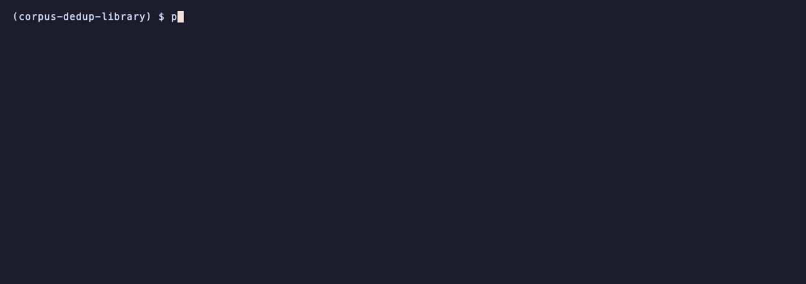
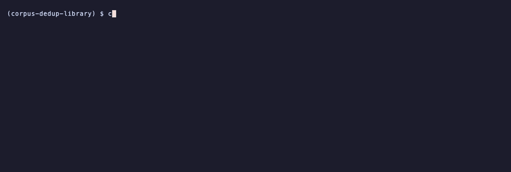

<h1 align="center">Corpus Dedup Library</h1>

<p align="center">
  <em>A Python library with a fast Rust core that finds and removes near-duplicate and low-quality documents from large text collections used to train AI language models.</em>
</p>

<p align="center">
  <a href="https://github.com/adeoluo/corpus-dedup-library/actions/workflows/ci.yml"></a>
  <a href="https://github.com/adeoluo/corpus-dedup-library/releases"></a>
  
  
  <a href="LICENSE"></a>
</p>

---

> **Evidence level: publicly benchmarked.** The library was run on 1.4 million documents from C4 (the Colossal Clean Crawled Corpus, a public collection of English web pages). Tests check that the Rust core gives bit-exact results compared with the Python reference version. It was also compared directly with datasketch, a popular Python library for the same task. The results have not been independently reproduced, and the library is not used in production. [What the levels mean](https://github.com/adeoluo#evidence-levels).

## Highlights

AI language models learn from very large collections of text. Copies inside such a collection
waste training time and can bias the model. This library finds and removes near-copies quickly.

- **It deduplicated 1.4 million real web pages in 30.5 seconds.** The pages hold 3.3 GB of
  text and were processed on one laptop with a peak memory of 1.2 GB. It removed 48,572
  near-copies, which is 3.4% of the pages.
- **In its exact-check mode it is 13.7 times faster than datasketch and finds more true copies.**
  datasketch is a widely used Python library for this task. On 50,000 web pages this library
  found 99.1% of the truly similar pairs that any run found, compared with 63.5% for
  datasketch. Every pair it reported was correct.
- **The fast Rust version gives exactly the same answers as the readable Python version.** Tests
  compare the two bit for bit on random and difficult Unicode text across several settings. On
  synthetic text the Rust version is 149 to 175 times faster.

**Where it falls short:** it compares wording, not meaning, so a copy rewritten in different
words is not caught. All timings come from one laptop. It has not been compared with the
large-scale pipelines datatrove and text-dedup.

## Key terms

Plain definitions of the terms used in this README.

| Term | Meaning |
|---|---|
| All-pairs comparison | Comparing every document with every other document. The work grows with the square of the number of documents, so it becomes too slow for large collections. |
| Band and row | LSH cuts each signature into bands of a few numbers each (rows). Two documents become a candidate pair if any band matches. The default is 16 bands of 4 rows. |
| Bit-exact | Two implementations give identical output, down to every bit, for the same input. Tests check this for the Rust core and the Python reference. |
| C4 | The Colossal Clean Crawled Corpus, a large public collection of English web pages used to train language models. It is split into files called shards. |
| Candidate pair | A pair of documents that LSH puts on a shortlist for a closer check. Only candidate pairs are compared against the threshold. |
| Cluster | A group of documents linked by confirmed near-copy pairs. The library keeps the first document of each cluster and drops the others. |
| datasketch | A widely used Python library for MinHash and LSH. It is the comparison baseline on C4 text. |
| datatrove | A library from Hugging Face for processing large text datasets, including deduplication. This project has not been compared with it. |
| Exact mode | The option `exact=True`. Each candidate pair is confirmed with its true Jaccard similarity instead of the faster MinHash estimate, so no pair below the threshold is reported. |
| Jaccard similarity | The overlap of two sets: shared items divided by all distinct items. From 0 (nothing shared) to 1 (identical). Here the sets are a document's shingles. |
| Locality-sensitive hashing (LSH) | A method that sorts signatures into buckets so that similar documents tend to land in the same bucket. Only documents that share a bucket are compared. |
| MinHash | A method that summarizes a document's shingles as a short signature. The share of matching positions in two signatures estimates their Jaccard similarity. |
| Near-duplicate | A document that is almost a copy of another one, for example the same text with one word changed or a sentence added. |
| Peak memory | The most memory a run uses at any moment, in mebibytes (MiB, 1,048,576 bytes) or gigabytes (GB). Lower is better. |
| Precision | Of the documents or pairs a method flags as near-copies, the share that really are. From 0 to 1, higher is better. |
| Quality filtering | Dropping low-quality text with simple rules, such as too few words, too few common words like "the", too many symbols, or heavy repetition. |
| Recall | Of the true near-copies, the share that a method finds. From 0 to 1, higher is better. |
| Reduction factor | The number of all possible document pairs divided by the number of candidate pairs actually compared, shown as "77x". Higher means less work. |
| Reference implementation | The plain Python version of the algorithm. It defines correct behavior, and the faster Rust core must match it. |
| Shingle | A short run of consecutive words from a document, turned into a number by a hash function. The library's default is 2 words (k=2). |
| Signature | A short, fixed-length list of numbers (64 by default) that summarizes a document's shingles. Similar documents get similar signatures. |
| Synthetic corpus | Test text generated by a program, with near-copies planted on purpose. The right answers are known, so precision and recall can be measured exactly. |
| text-dedup | An open-source collection of text deduplication scripts, including MinHash and LSH. This project has not been compared with it. |
| Threshold | The minimum Jaccard similarity for two documents to count as near-copies. The default is 0.6. |
| Throughput | The number of documents processed per second. Higher is better. |

## Motivation

A language model can only be as good as the text it learns from. Two of the most important
cleaning steps are **near-deduplication** and **quality filtering**. Near-deduplication removes
documents that are almost copies of each other. Quality filtering drops broken or meaningless
text. Exact deduplication by comparing every pair of documents is quadratic: the work grows with
the square of the number of documents. It also misses near-copies that differ by a small edit.

This library builds the standard scalable method from scratch. **MinHash** cheaply estimates the
Jaccard similarity of two documents, which is the share of word sequences they have in common.
**Locality-sensitive hashing** then shortlists only the pairs that are likely to be similar. So the
work grows roughly in line with the number of documents.

The main result is that the method works and that it is cheap. On a labeled synthetic corpus, it
removes the planted near-copies with **perfect precision and recall** (both 1.000 on a scale from
0 to 1). It compares only a small fraction of all pairs, and this saving grows with corpus size.

## Architecture

<p align="center">
  
</p>

<sub>Legend: amber = entry points and external systems, indigo = core logic, green = data and state, blue = validation and control, grey = observability and outputs.</sub>

Each document is split into shingles, which are short runs of consecutive words, and each
shingle is turned into a number by a hash function. MinHash reduces this set of numbers to a short
signature. LSH cuts each signature into bands and puts documents with a matching band into the
same bucket, so similar documents tend to meet. Each pair that meets is checked against a Jaccard
threshold. A union-find structure (a fast way to merge items into groups) then collects the
confirmed duplicates into clusters, and one document per cluster is kept.

Quality filtering runs separately. It applies configurable rules of thumb to each document and
returns the reasons a document failed. The HTTP service checks the number and the size of the
documents in each request and keeps no corpus between requests. It also publishes Prometheus
metrics (request counters in the format read by the Prometheus monitoring system). The report
measures detection precision and recall on a synthetic corpus with known duplicates. The
architecture decision records ([ADRs](docs/adr/)) explain the key design choices.

### What it implements

- **MinHash** with a fixed 64-bit hash and a family of ``(a*h + b) mod p`` permutations (simple
  formulas that reorder the hash values). The share of signature positions where two documents
  agree estimates their Jaccard similarity.
- **LSH banding** with adjustable numbers of bands and rows. These settings decide how similar
  two documents must be before they are likely to land in the same bucket.
- **A deduplication pipeline**. It finds candidate pairs and checks each one against the
  threshold, with either the estimated or the exact Jaccard similarity. It then groups the
  confirmed pairs with union-find and keeps one document per group.
- **A Rust core** (`rust/`). It runs the same MinHash, LSH banding, and clustering, with results
  that match the Python reference bit for bit in the parity tests. It computes signatures in
  parallel and releases the GIL (Python's global interpreter lock, which otherwise lets only one
  thread run at a time). Python uses it as the default backend, compiled into the package on
  install. It also ships as a standalone `corpus-dedup` command for JSONL streams (text with one
  JSON record per line). The Python implementation is the reference.
- **Rule-based quality filters** for document length, mean word length, stop-word ratio (the
  share of very common words such as "the"), symbol ratio, and word repetition. Each filter is a
  separate rule that can be inspected.

## Results

> Reproduce with `uv run python benchmarks/benchmark.py` (`python -m corpus_dedup_library report`
> prints the first row). The labeled corpus contains planted near-copies, for example exact
> copies, copies with a clause added, and copies with one word changed. So detection can be
> scored against the known answer.

This table shows detection quality and saved work for two synthetic corpus sizes, one per row.
Precision and recall (0 to 1) and the reduction compared with an all-pairs check (last column)
are all better when higher.

| Corpus size | Precision | Recall | Pairs compared | Fewer than all-pairs |
|---|---:|---:|---:|---:|
| 90 documents | 1.000 | 1.000 | 52 / 4,005 | **77x** |
| 270 documents | 1.000 | 1.000 | 174 / 36,315 | **209x** |

Detection is exact on this corpus (**precision and recall 1.000**). LSH compares only a tiny
fraction of all pairs. The number of candidate pairs grows far more slowly than the number of all
pairs, which grows with the square of the corpus size. So the reduction **grows with corpus
size**, from 77 times fewer comparisons at 90 documents to 209 times fewer at 270.

### Scale, throughput, and memory

> Reproduce with `uv run python benchmarks/scale.py`, which uses the default Rust backend.
> The corpora are synthetic: two thirds unique documents and one third near-copies. Peak memory
> is measured with `tracemalloc` (Python's built-in memory tracer). So it counts memory allocated
> by Python, not memory held by the Rust core.

Each row is one synthetic corpus size, run on the default Rust backend. Lower runtime and peak
memory are better, and higher throughput, reduction, precision and recall are better.

| Documents | Runtime | Throughput | Peak memory | Candidate pairs | Fewer than all-pairs | Precision | Recall |
|---|---:|---:|---:|---:|---:|---:|---:|
| 1,050 | 0.03 s | ~35,000 docs/s | 2.8 MiB | 442 | 1,246x | 1.000 | 0.997 |
| 3,000 | 0.08 s | ~36,800 docs/s | 8.0 MiB | 1,310 | 3,434x | 1.000 | 0.988 |
| 6,000 | 0.17 s | ~36,300 docs/s | 16.1 MiB | 2,634 | 6,833x | 1.000 | 0.992 |
| 10,500 | 0.27 s | ~38,300 docs/s | 28.3 MiB | 4,900 | 11,249x | 1.000 | 0.995 |

An earlier version of this table was measured on the Python reference backend, before Rust
became the default. That version reached about 285 documents per second and used 80 MiB at 10,500
documents. The candidate-pair, precision and recall columns are the same on both backends.

Throughput stays about the same per document as the corpus grows, and memory grows in line with
corpus size. Meanwhile the candidate-pair reduction keeps widening, to more than 11,000 times
fewer comparisons at 10,500 documents. In a test, unusual duplicate shapes are detected: exact
copies, odd whitespace, repeated text, and near-copies with non-ASCII text (characters outside
basic English) appended. A paraphrase that says the same thing with little shared wording is
**not** detected. This is the expected limit of word-shingle MinHash, which measures shared
wording, not meaning. It is not an implementation defect. These corpora are still synthetic.
They measure speed and memory use, not accuracy on real web text at the scale used to pretrain
language models.

### Real web text at scale (C4)

> Reproduce: download C4 English shards (parts of the dataset) from
> `https://huggingface.co/datasets/allenai/c4/resolve/main/en/c4-train.0000N-of-01024.json.gz`,
> then run `corpus-dedup --input c4.jsonl --output deduped.jsonl` and
> `uv run --no-sync --with datasketch python benchmarks/compare_datasketch.py --c4 <shard>`.
> Hardware: Apple M1 with 8 cores.

**1.4 million documents.** The command-line tool deduplicates the first four C4 shards in
**30.5 seconds**, with a peak memory of 1.2 GB. These shards hold 1,425,269 real web documents
(3.3 GB of JSONL). The tool drops 48,572 near-duplicates (3.4%) in 10,137 clusters, after
checking 4.6 million candidate pairs. With `--input`, it keeps only signatures and byte offsets
(positions in the file) in memory. It then copies the kept lines from the file in a second pass.
So memory grows with the number of documents, not with their length.

**Against datasketch**, a widely used Python MinHash LSH library, on the first 50,000 C4
documents. The settings are threshold 0.6, 64 permutations, and word bigrams (pairs of
consecutive words). Every pair that either library reports is checked with the exact Jaccard
similarity. Recall is measured against the 4,082 truly similar pairs that any of the runs found.
A similar pair that no run found is not counted, so recall is an upper bound.

Each row is one library or mode on the same 50,000 documents. Lower time is better, and higher
documents per second, precision and recall (both from 0 to 1) are better.

| Library | Time | Documents per second | Pairs reported | Precision | Recall |
|---|---:|---:|---:|---:|---:|
| corpus-dedup-library (Rust backend) | 6.0 s | 8,342 | 3,824 | 0.876 | 0.821 |
| **corpus-dedup-library (Rust backend, exact=True)** | **5.2 s** | 9,528 | 4,044 | **1.000** | **0.991** |
| datasketch MinHashLSH | 71.1 s | 703 | 2,662 | 0.974 | 0.635 |

These timings were taken while other applications were loading the machine. So all three rows
are several times slower than on an idle M1. An earlier idle run took 0.9 s for the default mode
and 14.8 s for datasketch. What this table measures is the ratio between rows.

The default mode confirms candidates with the MinHash estimate, so some false pairs get through
(precision 0.876). `exact=True` confirms each candidate with the exact Jaccard similarity of the
two documents' shingle sets. This check now runs in Rust in parallel, so in this run it took no
more time than the estimate. The result is **precision 1.000 and recall 0.991, 13.7x faster than
datasketch**. datasketch reports fewer pairs. Its precision is higher than the estimate mode's,
but its recall is 0.635 because its banding is tuned more conservatively. On 10,000 documents
the Rust backend is 144 times faster than this library's own Python backend in the same loaded
run (215 times on the idle machine).

### Rust core

> Reproduce with `make bench-compare`. The synthetic corpora contain documents of 80 to 200
> words, with one planted near-copy per five documents. Default settings: 16 bands of 4 rows,
> k=2 (two-word shingles), threshold 0.6. Hardware: Apple M1 with 8 cores.

Each row is one corpus size, timed on the Python reference and on the Rust core. Lower times and
a higher speedup (Python time divided by Rust time) are better, and the last column shows whether
both gave the same result.

| Documents | Python | Rust | Speedup | Identical result |
|---:|---:|---:|---:|:---:|
| 1,200 | 2.07 s | 0.014 s | 149x | yes |
| 6,000 | 10.27 s | 0.059 s | 175x | yes |
| 24,000 | 41.27 s | 0.260 s | 159x | yes |

The Python implementation stays the reference. The Rust backend returns the same `DedupResult`
(kept and dropped ids, confirmed pairs, clusters). The parity tests check this on random text and
on difficult Unicode text, including Python's rules for whitespace and lowercasing.

### Evaluation

The labeled corpus and all hashing are deterministic, which means the same input always gives
the same output. So every precision, recall and candidate-pair number for the labeled corpus can
be reproduced offline. The full method and tables are in
[`docs/EVALUATION_REPORT.md`](docs/EVALUATION_REPORT.md).

### Comparison scope

The precision, recall, and candidate-pair reduction in the first results table come from a small
synthetic corpus (90 to 270 documents) with planted near-duplicates. They are compared with an
exhaustive all-pairs check, not with an established deduplication pipeline at scale. Perfect
accuracy on planted duplicates is not evidence of the same accuracy on varied web text. This
corpus is also far smaller than the collections used to pretrain language models. This project
has **not** been benchmarked against [datatrove](https://github.com/huggingface/datatrove) or
[text-dedup](https://github.com/ChenghaoMou/text-dedup), and it does not claim to beat them. The
result shows that the MinHash and LSH mechanics are correct and that candidate pairs grow far
more slowly than all pairs. A large-scale evaluation with memory and throughput measurements is
the natural next step.

## Quickstart

```bash
git clone https://github.com/adeoluo/corpus-dedup-library.git && cd corpus-dedup-library
make setup                      # install (compiles the Rust core; needs a Rust toolchain) + hooks
make all                        # lint + type-check + test

python -m corpus_dedup_library report      # detection precision and recall
python -m corpus_dedup_library dedup        # deduplicate the built-in corpus
python -m corpus_dedup_library quality       # apply the quality filter
python -m corpus_dedup_library serve         # start the HTTP service on :8000
```

```python
from corpus_dedup_library import deduplicate, assess

result = deduplicate(["the cat sat here", "the cat sat here too", "unrelated finance text"])
print(result.keep, result.drop)
print(assess("!!! @@@ ###").reasons)  # ('too_few_stopwords', 'too_many_symbols')
```

## Usage

The animation below is a real run of the Rust command-line tool on 24,000 synthetic documents
with 4,000 planted near-copies. Regenerate it with `vhs docs/demo/dedup.tape` (vhs records
terminal sessions as animations).

<p align="center">
  
</p>

### Demonstration

```text
$ python -m corpus_dedup_library report
Near-duplicate detection against ground truth:
  precision=1.000, recall=1.000, f1=1.000; 52/4005 pairs compared (77x fewer)

$ python -m corpus_dedup_library quality
Quality filter over 93 documents:
  kept 90, rejected 3
  doc 90: too_few_words, too_few_stopwords
  doc 91: too_few_stopwords, too_many_symbols
  doc 92: too_repetitive
```

### Rust backend and CLI

Installing the package compiles the Rust core into it, and `deduplicate` uses it by default.
After editing `rust/`, run `make rust-develop` to rebuild it in place.

```python
from corpus_dedup_library.dedup import deduplicate

result = deduplicate(documents)  # Rust core (backend="auto")
exact = deduplicate(documents, exact=True)  # exact Jaccard check, also in Rust
reference = deduplicate(documents, backend="python")  # identical result, readable reference
```

The same core ships as a command-line tool (CLI) that streams JSONL. It keeps the first line of
each near-duplicate cluster, in input order, and writes a summary to stderr (the error output
stream). Install a prebuilt binary from the GitHub release, or build it from this repository:

```text
$ curl -fsSL https://raw.githubusercontent.com/adeoluo/corpus-dedup-library/main/scripts/install.sh | sh   # prebuilt, checksum verified
$ corpus-dedup --threshold 0.6 < corpus.jsonl > deduped.jsonl
documents=2400 kept=2000 dropped=400 clusters=400 candidate_pairs=400 seconds=0.030
```

### HTTP service

The HTTP service uses only Python's standard library and holds no corpus state. Each request
carries its own documents. The routing logic is a pure function (its output depends only on its
input), so it is tested without opening a network socket.

| Method | Path | Purpose |
|---|---|---|
| GET | `/health` | liveness |
| GET | `/ready` | readiness |
| GET | `/metrics` | per-route request, error, and latency metrics (Prometheus text) |
| POST | `/dedup` | body `{"documents": [str], "threshold": float?}`; keep and drop ids |
| POST | `/quality` | body `{"text": str}`; whether the text passes and why not |
| GET | `/report` | near-duplicate detection precision and recall on the built-in corpus |

### Demos

These were recorded from real runs with [vhs](https://github.com/charmbracelet/vhs), a tool that
records terminal sessions. Each recording script (tape) is in `docs/demo/`.

Detection precision and recall on the labeled corpus, then the quality filter.

<p align="center">
  
</p>

The HTTP service deduplicating three documents, then the quality filter.

<p align="center">
  
</p>

## Design decisions

- **MinHash plus LSH instead of an exact all-pairs comparison.** Exact pairwise Jaccard
  similarity is quadratic. MinHash and LSH bring the cost close to linear while estimating
  similarity. See [ADR 0002](docs/adr/0002-minhash-lsh.md).
- **A verification step after LSH.** LSH produces candidates, not decisions. Checking each
  candidate against a threshold controls precision. See
  [ADR 0003](docs/adr/0003-verify-candidates.md).
- **A Rust core that is bit-exact with Python.** The hashing is limited by processor speed and
  splits easily into independent parallel tasks, so it moves to Rust. The Python code stays the
  specification, and parity tests compare the two on every continuous integration (CI) run. See
  [ADR 0004](docs/adr/0004-rust-core-with-parity.md).

## Testing

```bash
make test                     # or: uv run pytest
uv run pytest --cov=src --cov-report=term-missing --cov-fail-under=80
```

The test suite in `tests/` uses deterministic hashing and synthetic corpora:

- `test_dedup.py`: shingling, the bounds of exact Jaccard similarity, MinHash estimates and
  determinism, LSH shortlisting of candidate pairs and signature checks, and near-duplicate
  removal (the estimated and exact modes agree). It also covers detection precision and recall,
  unusual duplicate shapes, the documented limit that a low-overlap paraphrase is not detected,
  the scale report, and the quality filters (natural prose accepted, degenerate text rejected,
  adjustable settings).
- `test_rust_parity.py`: the Rust signatures, candidate pairs, and full `deduplicate` results
  equal Python's across shingle sizes, seeds, band layouts, thresholds, and difficult Unicode
  text (Greek final sigma, Turkish dotted capital I, U+001C to U+001F separator characters,
  emoji). `test_backend.py` covers backend selection with and without the extension.
- `rust/`: unit tests for hashing, shingling, banding, and clustering, plus end-to-end tests
  of the `corpus-dedup` binary (`cargo test`, Rust's test runner).
- `test_service_cli.py`: the HTTP handler layer (`/health`, `/ready`, `/dedup`, `/quality`,
  `/report`, `/metrics`, validation, unknown routes) and the CLI commands.

CI (`.github/workflows/ci.yml`) runs `ruff format --check` and `ruff check` (a Python formatter
and code checker), `mypy src` (a type checker), and `pytest` (the test runner). The tests must
cover at least 80% of the code, on Python 3.12, 3.13, 3.14 and 3.15. CI then builds the package
and the Docker image. A separate job runs `cargo fmt` and `clippy` (Rust's formatter and code
checker, with and without the Python feature) and `cargo test`. It then builds the extension
with maturin (a tool that builds Rust extensions for Python) and runs the parity tests with the
extension required.

## Responsible AI

- **Model card:** [`docs/MODEL_CARD.md`](docs/MODEL_CARD.md)
- **Data card:** [`docs/DATA_CARD.md`](docs/DATA_CARD.md)
- **Threat model:** [`docs/THREAT_MODEL.md`](docs/THREAT_MODEL.md)

## Limitations

- Installing from source compiles the Rust core, so it needs a Rust toolchain (the Rust compiler
  and build tools).
- The library holds all signatures in memory, so the corpus size is limited by RAM. The
  command-line tool's `--input` mode keeps only signatures and file offsets. The Python
  reference backend hashes at roughly 280 documents per second.
- Bands, rows, and the threshold set the balance between catching more copies and making fewer
  false matches. The defaults suit the bundled corpus and may need tuning for collections with
  different similarity patterns.
- The quality filters are rules of thumb and do not detect the language of a document. The
  stop-word rule uses a short list of English words. A production pipeline would add language
  identification and filters based on trained models.

## Roadmap

- [ ] Evaluate on a real large corpus with memory and throughput measurements, compared against datatrove or text-dedup.
- [ ] Add a streaming mode that indexes documents without holding them all in memory.
- [ ] Add a learned quality classifier alongside the heuristics.
- [ ] Add exact sub-document (span) overlap detection.

## License

Released under the [MIT License](LICENSE).
